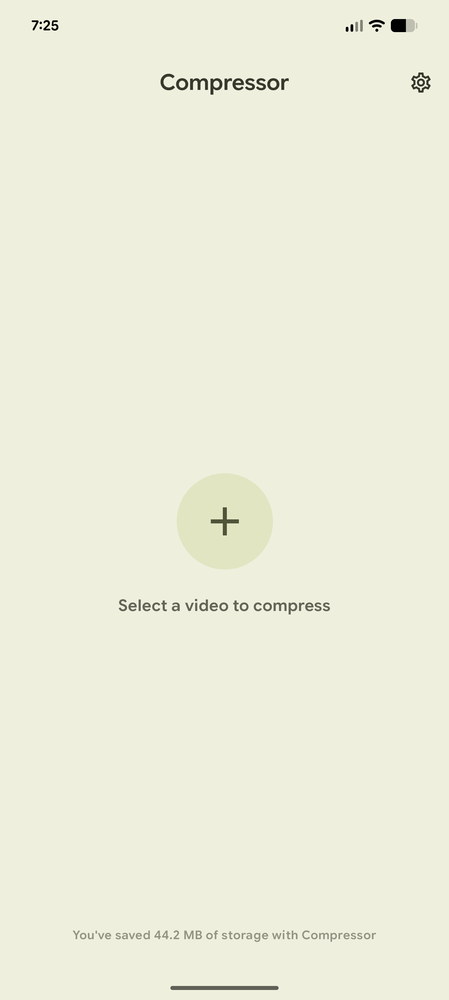
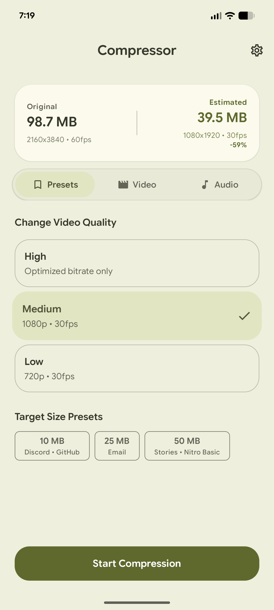
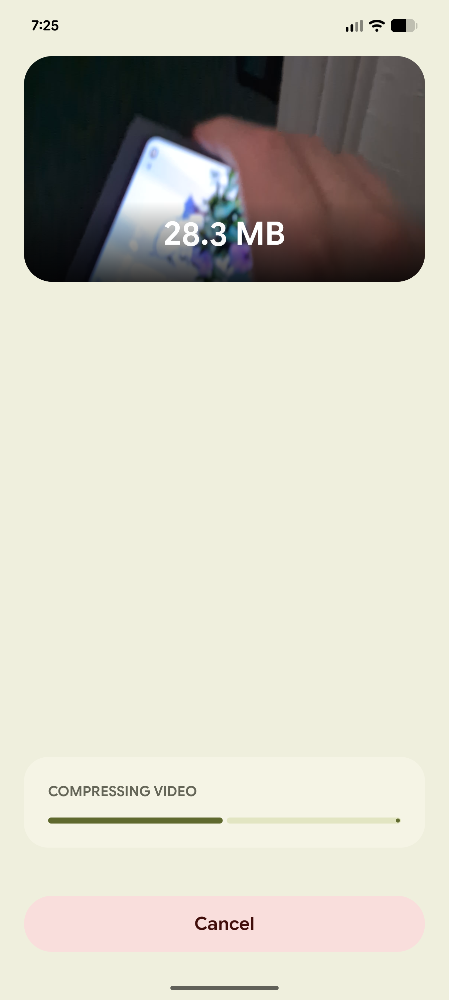
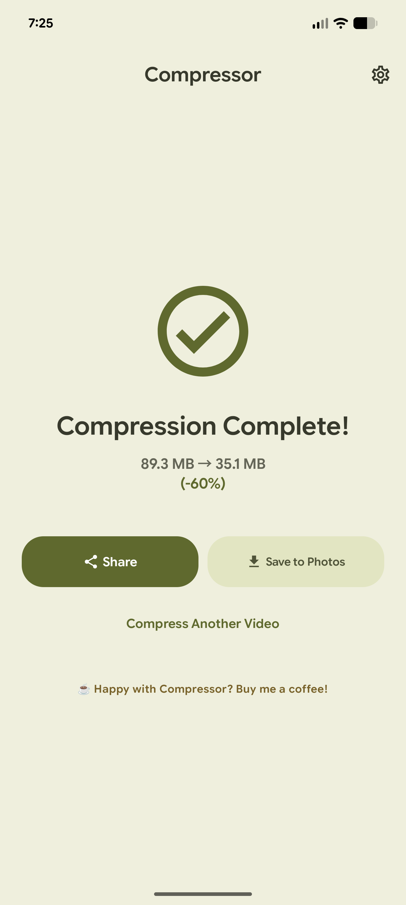

<div align="center">
  

# Mampat

Aplikasi kompresi video native untuk Android yang super cepat, bebas iklan, dan sangat ringan.


<br>

   
</div>

---

## Developer

| | |
|---|---|
| **Developer** | Hanz Dev Official |
| **Kontak** | [hanzzcodee@gmail.com](mailto:hanzzcodee@gmail.com) |
| **Dukung** | [https://saweria.co/hanzreally](https://saweria.co/hanzreally) |

Suka dengan Mampat? Dukung pengembangannya lewat [Saweria](https://saweria.co/hanzreally) 💛

---

## Fitur
- Kompresi video secepat kilat memakai akselerasi perangkat keras
- Memakai pustaka Media3 bawaan Android, bukan pembungkus FFmpeg yang lambat dan besar
- Dukungan H.265 dan AV1 untuk perangkat yang kompatibel
- Mendukung menu Bagikan (Share Sheet)
- Tanpa pustaka pihak ketiga
- Tanpa izin yang invasif (tanpa akses penyimpanan, tanpa internet, dll.)
- Bebas iklan
- Sepenuhnya native Kotlin
- Tampilan sederhana dan bersih
- Berjalan di Android 7.0 ke atas
- Antarmuka sepenuhnya berbahasa Indonesia
- Preset ukuran target untuk Discord, WhatsApp, Telegram, Email, dan lainnya
- Pembuat nama file yang bisa disesuaikan
- Pengaturan bawaan untuk video dan audio

---

## Cara Menggunakan
1. Buka **Mampat** lalu ketuk tombol **Tambah Video**, atau bagikan video langsung dari galeri ke aplikasi ini.
2. Pilih preset kualitas atau ukuran target, lalu sesuaikan opsi video dan audio bila perlu.
3. Ketuk **Mulai Kompresi** dan tunggu hingga selesai.
4. Simpan atau bagikan video hasil kompresi. Video asli dapat dihapus langsung dari aplikasi.

---

## Membangun dari Kode Sumber
1. Pasang Android Studio versi terbaru dan JDK 17.
2. Buka folder proyek ini di Android Studio.
3. Tunggu sinkronisasi Gradle selesai.
4. Jalankan perintah berikut untuk membuat APK release:

```bash
./gradlew assembleRelease
```

APK hasil build ada di `app/build/outputs/apk/release/` dengan nama `app-release-unsigned.apk` (belum ditandatangani).

---

## Privasi
Mampat tidak mengumpulkan data apa pun dan tidak memiliki izin internet. Seluruh proses berjalan di perangkat Anda. Baca selengkapnya di [PRIVACY.md](PRIVACY.md).

---

## Kontribusi
Saran, laporan bug, dan kontribusi sangat disambut. Silakan hubungi developer lewat email di [hanzzcodee@gmail.com](mailto:hanzzcodee@gmail.com). Harap baca [Kode Etik](CODE_OF_CONDUCT.md) sebelum berkontribusi.

---

## Lisensi
Proyek ini dirilis di bawah lisensi MIT. Lihat berkas [LICENSE](LICENSE) untuk selengkapnya. Mampat dikembangkan dari proyek sumber terbuka Compressor (lisensi MIT), sehingga pemberitahuan hak cipta aslinya tetap dipertahankan sesuai ketentuan lisensi.

---

**Developer:** Hanz Dev Official
**Kontak:** hanzzcodee@gmail.com
**Dukung:** https://saweria.co/hanzreally
